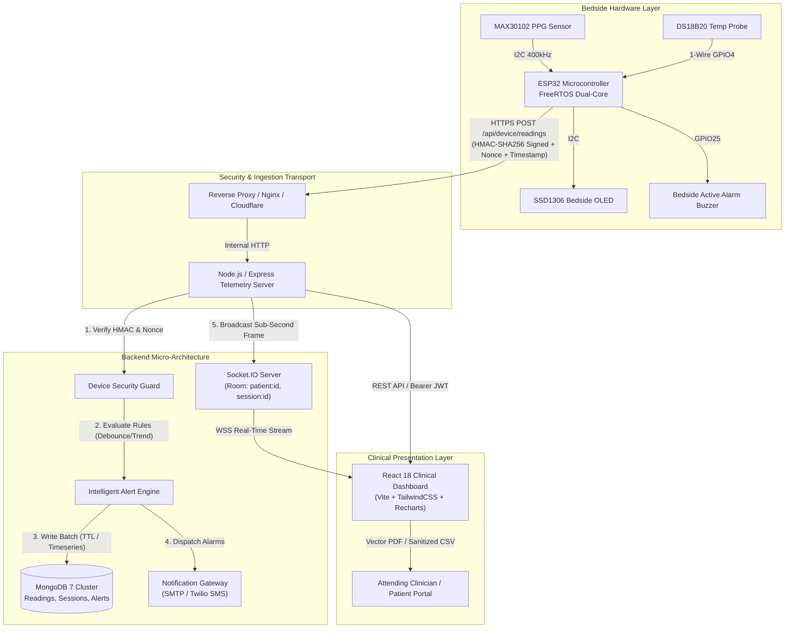
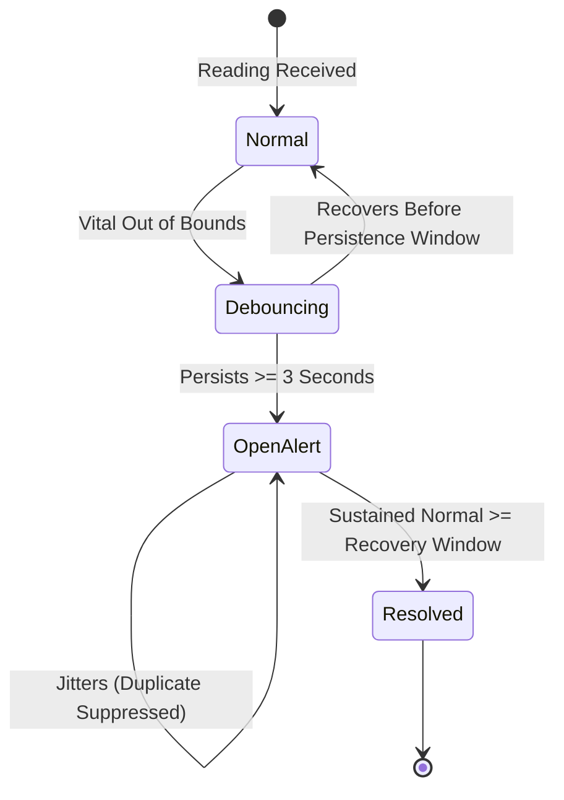

# PulseCare System Architecture & Data Flow

This document details the architectural topology, hardware task isolation, network security boundaries, and real-time data flow of the PulseCare telemetry platform.

---

## 1. High-Level Architecture Overview

PulseCare connects bedside IoT nodes to hospital clinical workstations through a layered, fault-tolerant topology:

---

## 2. Bedside Hardware Task Isolation (FreeRTOS)

The ESP32 microcontroller features dual Xtensa 32-bit LX6 cores operating at 240 MHz. PulseCare leverages FreeRTOS task pinning to guarantee that Wi-Fi network latency never starves sensor acquisition:

1. **Sensor & Sampling Task (Pinned to Core 1 - Priority 2)**:
   - Samples MAX30102 infrared and red channels at 100 Hz.
   - Computes AC/DC ratios for oxygen saturation (SpO2) and detects peak inflection for heart rate (BPM).
   - Polls DS18B20 1-Wire temperature bus asynchronously (750ms conversion interval).
   - Drives local SSD1306 128x64 OLED display at 10 FPS with local status.
   - Executes bedside buzzer tone generator if vitals breach critical bounds.
2. **Network & Ingestion Task (Pinned to Core 0 - Priority 1)**:
   - Manages Wi-Fi WPA2/WPA3 connection state and auto-reconnect logic.
   - Maintains an in-memory ring buffer (up to 300 offline samples in RTC RAM).
   - When Wi-Fi is active, drains buffer and transmits payloads via HTTPS.
   - Signs every payload with HMAC-SHA256 over canonical string `METHOD:PATH:TIMESTAMP:NONCE:BODY_SHA256`.

---

## 3. Server-Side Ingestion Pipeline

When telemetry reaches Express:
1. **Per-Device Rate Limiting**: Max 120 requests/minute per device ID.
2. **Status Gate**: Rejects revoked or inactive devices with `403 Forbidden`.
3. **Replay Defense**: Validates timestamp drift (< 60 seconds) and checks nonce against an in-memory TTL set.
4. **HMAC Cryptographic Verification**: Recalculates signature using stored device secret; mismatches terminate with `401 Unauthorized`.
5. **Persistence**: Ingests into MongoDB with compound index `{ patientId: 1, ts: -1 }`.
6. **Real-Time Distribution**: Emits `telemetry:new` to Socket.IO rooms scoped strictly to authorized clinicians.

---

## 4. Alert Engine Architecture

The alert engine operates on a multi-stage state machine to eliminate clinical alarm fatigue:

- **Persistence Debouncing**: Alarms trigger only after sustaining abnormal physiological values for `persistenceSeconds` (default 3s).
- **Trend Detection**: Flags rapid physiological degradation (e.g. Heart Rate changing > 20% in 5 minutes).
- **Duplicate Suppression**: Only one active alarm exists per `(session, alertType)`.
- **Auto-Recovery**: Resolves automatically once readings remain in normal range for consecutive samples.

---

## 5. Client Architecture (React Single Page Application)

The frontend is engineered as a zero-latency clinical workstation:
- **Routing & RBAC**: Managed via React Router 7 with `ProtectedRoute` (auth and temporary password redirect) and `RoleRoute` (role-based separation).
- **State Management**: `AuthContext` (in-memory JWT + token refresh callback), `ToastContext` (accessible live alerts).
- **Real-Time Visualizations**: Recharts SVG line charts with continuous 300-point buffer, sub-second latency, and responsive resize observers.
- **Design System**: Strict WCAG AA compliant palette (`#0B1F3A` navy, `#14B8A6` teal, `#2563EB` blue), tabular figures (`tabular-nums`) to prevent layout jitter, and dark mode toggling.
